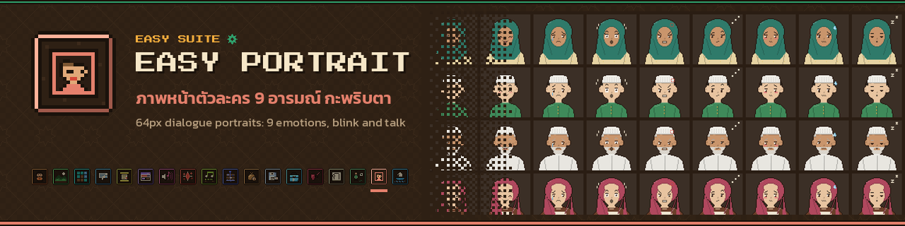
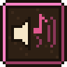
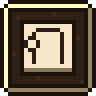
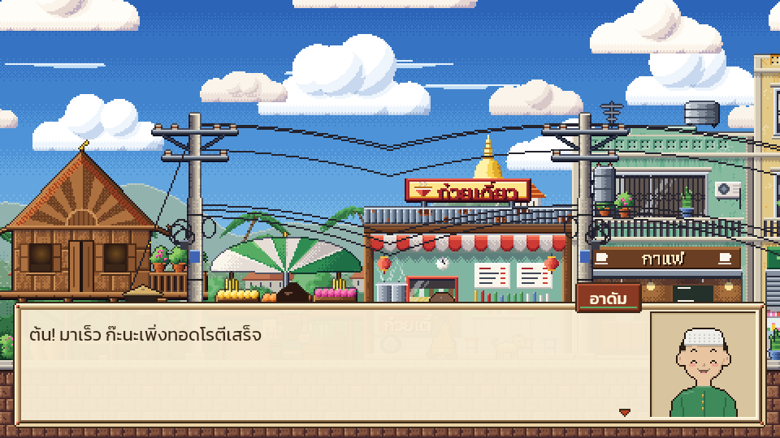
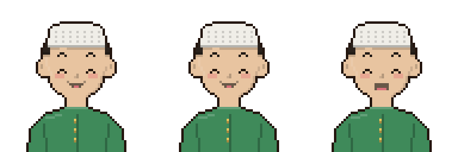

<!-- easy-suite:header:start -->
<p align="center">
  <a href="#easy-suite"></a>
</p>

<p align="center">
  <b>Easy Portrait</b> · ภาพหน้าตัวละคร 9 อารมณ์ กะพริบตา · 64px dialogue portraits: 9 emotions, blink and talk<br />
  <sub>Part of <a href="#easy-suite"><b>Easy Suite</b></a>: Thai-friendly pixel-art game dev tools for Godot 4.3+ and PixiJS v8</sub>
</p>

<p align="center">
  <a href="https://github.com/Saladin2020/easyportrait/actions/workflows/ci.yml"></a> <a href="LICENSE"></a>   <a href="docs/MCP.md"></a> 
</p>

<p align="center">
  <a href="https://github.com/Saladin2020/easysprite"></a>
  <a href="https://github.com/Saladin2020/easyscene"></a>
  <a href="https://github.com/Saladin2020/easytilemap"></a>
  <a href="https://github.com/Saladin2020/easydialogue"></a>
  <a href="https://github.com/Saladin2020/easyquest"></a>
  <a href="https://github.com/Saladin2020/easyui"></a>
  <a href="https://github.com/Saladin2020/easysfx"></a>
  <a href="https://github.com/Saladin2020/easyfx"></a>
  <a href="https://github.com/Saladin2020/easymusic"></a>
  <a href="https://github.com/Saladin2020/easyanim"></a>
  <a href="https://github.com/Saladin2020/easyitems"></a>
  <a href="https://github.com/Saladin2020/easysave"></a>
  <a href="https://github.com/Saladin2020/easykit"></a>
  <a href="https://github.com/Saladin2020/easybattle"></a>
  <a href="https://github.com/Saladin2020/easyfont"></a>
  <a href="https://github.com/Saladin2020/easynpc"></a>
  <a href="https://github.com/Saladin2020/easyportrait"></a>
  <a href="https://github.com/Saladin2020/easyship"></a>
</p>
<!-- easy-suite:header:end -->

# Easy Portrait

**ภาพหน้าตัวละคร 64×64 · 9 อารมณ์ · กะพริบตา / ขยับปาก · ฮิญาบ กปิเยาะห์ ซองก๊อก งอบ · ไทย Bahasa Melayu English**  
Dialogue portraits for your cast, drawn natively at 64×64 rather than upscaled from a walking sprite: nine emotions
(the seven [Easy Dialogue](../easydialogue) ones plus worried and sleepy), each with a **base, blink and talk** frame.
Build a portrait straight from an [Easy Sprite](../easysprite) paperdoll (body, skin, hair, hijab / tudung / kopiah /
songkok / cap / ngob, glasses and beard, shirt and colours carry over) or set it up by hand. Export to the **Easy
Dialogue portraits layout** (drop-in for the `town_*` sets), a **Godot 4.3+** `Portraits` autoload with an
`EasyPortrait` node that blinks and talks on its own, a **PixiJS v8** runtime, or PNG sheets. CLI, web editor and MCP
server; local only, no network.

<p align="center"></p>

| In Easy Dialogue (drop-in `town_kopiah_boy`) | PixiJS v8 demo, English names | base · blink · talk |
|---|---|---|
|  |  |  |

## The sample cast

`init` copies 20 portraits and the 25 Easy Sprite projects they come from. Eleven use Easy Dialogue's `town_*` ids
and the same names as its sample scripts, so exporting with `--out <easydialogue workspace>/portraits` replaces
those portraits in place:

<p align="center"></p>

| id | Who | Look |
|---|---|---|
| `town_hijab_teacher` | ก๊ะฟาตีมะห์ (Kak Fatimah) | green hijab, baju kurung |
| `town_kopiah_boy` | อาดัม (Adam) | kopiah, baju melayu |
| `town_pak_cik` | ปะจิอิสมะแอ (Pak Cik Ismail) | kopiah, white beard, jubah |
| `town_roti_seller` | ก๊ะนะ (Kak Na) | shawl, apron |
| `town_tadika_girl` | ไอชะฮ์ (Aisyah) | white school tudung |
| `town_monk` | หลวงพี่ (Luang Phi) | shaved head, saffron robe |
| `town_farmer` | ลุงมี (Uncle Mee) | ngob hat, mohom shirt |
| `town_elder` | ตาเพิ่ม (Grandpa Poem) | balding, mustache |
| `town_kid` | ต้น (Ton) | blue cap, yellow T-shirt |
| `town_vendor` | ป้าแดง (Auntie Daeng) | hair bun, apron |
| `town_student` | พี่ฝน (Fon) | long hair, school blazer |
| `pak_hamid`, `mak_yah`, `yai`, `ah_kong`, `noodle_auntie`, `kru_ploy`, `ustaz_yusof`, `bang_man`, `young_knight` | ปะฮามิด, เมาะยะห์, ยาย, อากงเฮง, เจ๊หมวย, ครูพลอย, อุสตาซยูโซะ, บังมัน, อัศวินน้อย | songkok, tudung sarung, grey bun, glasses, flower, serban, pha khao ma, armour |

Thai names are written in Thai. `check` warns when a Thai name isn't in Thai script, refuses Arabic script in names
(no calligraphy) and refuses prophets or other sacred figures as portraits.

## Quick start

```bash
npm install
npx tsx src/cli.ts init --workspace ~/cast                         # portraits/ sprites/
npx tsx src/cli.ts list --workspace ~/cast
npx tsx src/cli.ts render town_kopiah_boy --emotion ดีใจ --kind strip --out adam.png --workspace ~/cast
npx tsx src/cli.ts from-sprite songkok_groom --id pak_lah --th "ปะลาห์" --en "Pak Lah" --workspace ~/cast
npx tsx src/cli.ts export --preset dialogue --out ~/my-dialogue/portraits --workspace ~/cast
npx tsx src/cli.ts export --workspace ~/cast                       # exports/easyportrait-{dialogue,godot,pixi,png}/
npx tsx src/cli.ts serve --workspace ~/cast                        # web editor on http://127.0.0.1:8968
```

Other commands: `info`, `show <id>`, `options`, `set <id> --headwear songkok --features glasses,beard …`,
`remove <id>`, `check`, `render [ids] --kind portrait|strip|sheet --frame blink --emotions …`.

## Portraits

A spec is a few fields — body (`adult`, `child`, `elder`, `stocky`), skin / hair / shirt colours, a hair style, an
optional headwear and face features — see [docs/FORMAT.md](docs/FORMAT.md). Hijab styles (`hijab`, `tudung_school`,
`tudung_sarung`, `shawl`) frame the face and hide the hair; hats (`kopiah`, `songkok`, `serban`, `cap`, `ngob`,
`pha_khao_ma`, `flower`) sit over it. Emotion names accept Thai and Malay aliases (`ดีใจ`, `marah`, `เขิน`) like Easy
Dialogue does.

Every portrait blinks on its own: every 3.2 s plus 0.35 s × a per-character seed (0–6, from the id), for 0.14 s, so
a cast on screen never blinks in sync. While talking the mouth alternates every 0.12 s. Sleepy portraits don't
blink. The same timing (`src/shared/engine.ts`) runs in the CLI, the Pixi runtime (bundled as
`easyportrait-core.js`) and GDScript, and the Godot test checks it frame by frame.

## Export

| Preset | Output |
|---|---|
| `dialogue` | Easy Dialogue layout: `<id>/<emotion>.png` (64×64; the 7 dialogue emotions, `--all-emotions` for all 9), `<id>/frames/<emotion>.png` (192×64: base, blink, talk; Easy Dialogue lists only top-level PNGs, so the strips don't show up as emotions), `<id>/portrait.json` |
| `godot` | Godot 4.3+ project: `easyportrait/` (`Portraits` autoload, `EasyPortrait` TextureRect, the same portrait folders, index, Kanit), demo `main.tscn` (1–9 emotion, Space talk, L language), `test_portrait.gd`, `capture.gd` |
| `pixi` | `easyportrait-core.js`, `easyportrait-pixi.js`, `portraits.json`, the portrait folders, demo `index.html` |
| `png` | `sheet.png` (everyone × every emotion), `sheet@3x.png`, `cast.png`, `characters/<id>@4x.png` |

## Godot 4.3+

```gdscript
# Project Settings → Autoload → res://easyportrait/portraits.gd as "Portraits"
var face := EasyPortrait.new()
face.custom_minimum_size = Vector2(128, 128)
add_child(face)
face.character = "town_kopiah_boy"
face.emotion = "ดีใจ"          # or "happy"
face.say(1.6)                  # talks for 1.6 s, then emits finished_talking
Portraits.name_of("town_kopiah_boy", "ms")   # "Adam"
```

`godot --headless --path exports/easyportrait-godot --script res://test_portrait.gd` prints `OK`.

## PixiJS v8

```js
import { loadPortraits } from "./easyportrait-pixi.js";
const lib = await loadPortraits(PIXI, "portraits.json");
const face = await lib.portrait("town_hijab_teacher", { emotion: "happy", scale: 3, label: "th" });
app.stage.addChild(face.container);
app.ticker.add((t) => face.update(t.deltaMS / 1000));
face.say(2); await face.setEmotion("terkejut");
```

`python3 scripts/check-pixi.py exports/easyportrait-pixi shot.png` loads the demo in headless Chrome and checks the
frames against the core timing, `say()` and the emotion aliases.

## Web editor

`serve` opens the cast list, a large live preview (blinking, ▶ talk), every emotion and frame side by side, the spec
form (names, body, hair, headwear, shirt, colours, features, background) validated as you type, a sheet of everyone,
an Easy Sprite importer and the check. Portraits are drawn in the browser by the same code as the CLI.

<p align="center"></p>

## MCP server

`npm run mcp` (stdio) or `npm run mcp:http` (port 8969). Tools: `workspace_info`, `get_portrait`, `write_portrait`,
`from_sprite`, `render_portrait` (returns a PNG), `check_portraits`, `export_portraits`. See [docs/MCP.md](docs/MCP.md).

## Ports

| | Port |
|---|---|
| Web editor / API | 8968 |
| MCP Streamable HTTP | 8969 |
| Vite dev UI | 5196 |

Everything binds to 127.0.0.1; a non-loopback `--host` needs the printed token. Paths outside the workspace are refused
unless listed in `EASYPORTRAIT_ALLOWED_DIRS` (the CLI's own `--out` is trusted).

## Development

```bash
npm test                                                  # vitest
GODOT=/path/to/godot npx vitest run test/godot.test.ts    # headless Godot: timing parity, textures, EasyPortrait node
npm run typecheck
npm run smoke                                             # CLI + MCP (stdio and HTTP)
npm run check:pixi -- exports/easyportrait-pixi shot.png  # headless Chrome
node scripts/build-core.mjs                               # after editing src/shared/engine.ts
```

<!-- easy-suite:table:start -->
## Easy Suite


Eighteen small, local-first tools that share one look (teak, lantern gold, Kanit, 16/48px pixels), one
workflow (CLI · web editor · MCP server) and the same targets (**Godot 4.3+** and **PixiJS v8**).
ชุดเครื่องมือทำเกมพิกเซลสไตล์ไทย ใช้ร่วมกันได้ทั้งชุด · the samples share one multicultural southern Thai village.

| | Tool | What it does | Repo |
|:-:|---|---|---|
|  | [**Easy Sprite**](https://github.com/Saladin2020/easysprite) | Compose modular 48px chibi characters (top-down + side-view) and export sheets. | [`easysprite`](https://github.com/Saladin2020/easysprite) |
|  | [**Easy Scene**](https://github.com/Saladin2020/easyscene) | Side-view levels: parallax layers, 16px autotiles, Thai town props. | [`easyscene`](https://github.com/Saladin2020/easyscene) |
|  | [**Easy Tilemap**](https://github.com/Saladin2020/easytilemap) | Top-down 16px maps: blob-47 autotiles, objects, collision, spawns. | [`easytilemap`](https://github.com/Saladin2020/easytilemap) |
|  | [**Easy Dialogue**](https://github.com/Saladin2020/easydialogue) | Branching `.ezd` dialogue with Thai-safe text, portraits and choices. | [`easydialogue`](https://github.com/Saladin2020/easydialogue) |
|  | [**Easy Quest**](https://github.com/Saladin2020/easyquest) | Text `.ezq` quests: steps, flags, items, rewards, linked to dialogue. | [`easyquest`](https://github.com/Saladin2020/easyquest) |
|  | [**Easy UI**](https://github.com/Saladin2020/easyui) | Nine-slice pixel UI kit: panels, bars, inventory, menus, 30 icons. | [`easyui`](https://github.com/Saladin2020/easyui) |
|  | [**Easy SFX**](https://github.com/Saladin2020/easysfx) | Deterministic 8-bit SFX and 4-channel chiptune loops, typing blips. | [`easysfx`](https://github.com/Saladin2020/easysfx) |
|  | [**Easy FX**](https://github.com/Saladin2020/easyfx) | Pixel particles: sparks, fire, rain, lanterns, Raya pelita; sheets + Godot particles. | [`easyfx`](https://github.com/Saladin2020/easyfx) |
|  | [**Easy Music**](https://github.com/Saladin2020/easymusic) | Seeded Thai loop music: ranat, khong wong, saw, khim, pi, kompang; seamless WAV/OGG loops. | [`easymusic`](https://github.com/Saladin2020/easymusic) |
|  | [**Easy Anim**](https://github.com/Saladin2020/easyanim) | Cutscene timelines: actors, camera, dialogue, FX and music cues; Godot + Pixi runners. | [`easyanim`](https://github.com/Saladin2020/easyanim) |
|  | [**Easy Items**](https://github.com/Saladin2020/easyitems) | Item database, shops, inventory, loot tables and crafting; 44 starter items with pixel icons. | [`easyitems`](https://github.com/Saladin2020/easyitems) |
|  | [**Easy Save**](https://github.com/Saladin2020/easysave) | Versioned save slots with migrations and checksums; Thai / English / Malay string tables. | [`easysave`](https://github.com/Saladin2020/easysave) |
|  | [**Easy Kit**](https://github.com/Saladin2020/easykit) | One command drives the Easy tools into a playable Godot 4.3+ and PixiJS game (portraits, schedules, battles, Thai pixel font) and ships it with Easy Ship; unified MCP server and `doctor`. | [`easykit`](https://github.com/Saladin2020/easykit) |
|  | [**Easy Battle**](https://github.com/Saladin2020/easybattle) | Turn-based battles: party, bestiary, skills, statuses, bosses; seeded simulator; Godot + Pixi runtimes. | [`easybattle`](https://github.com/Saladin2020/easybattle) |
|  | [**Easy Font**](https://github.com/Saladin2020/easyfont) | Pixel bitmap fonts for Thai, Latin and Malay: stacking vowels and tones, BMFont / TTF for Godot + Pixi. | [`easyfont`](https://github.com/Saladin2020/easyfont) |
|  | [**Easy NPC**](https://github.com/Saladin2020/easynpc) | NPC daily schedules with A* on Easy Tilemap maps, day / night, affinity, dialogue and quest hooks. | [`easynpc`](https://github.com/Saladin2020/easynpc) |
|  | **Easy Portrait** ← you are here | 64×64 dialogue portraits with 9 emotions, blink and talk frames, from Easy Sprite characters. | [`easyportrait`](https://github.com/Saladin2020/easyportrait) |
|  | [**Easy Ship**](https://github.com/Saladin2020/easyship) | Toolchain doctor, web / Windows / Linux / Android builds, itch.io zips and butler plans; dry run by default. | [`easyship`](https://github.com/Saladin2020/easyship) |
<!-- easy-suite:table:end -->

## Credits

Portrait art is generated by this tool's code (MIT). Sample sprite projects come from Easy Sprite. Kanit font: SIL OFL
1.1. See [CREDITS.md](CREDITS.md).
